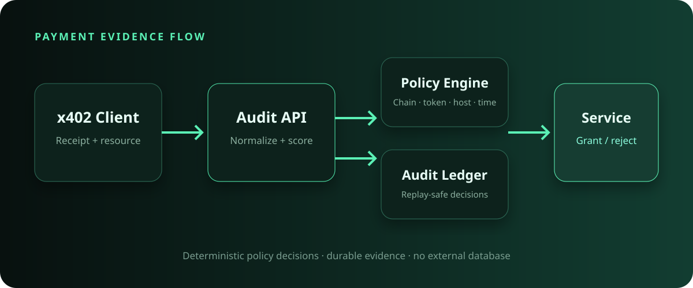

# Kite x402 Receipt Auditor

An open-source security gateway for validating x402 payment receipts before an API grants access to a protected resource. It is designed for KiteAI testnet services and works without an external database.



## Why this exists

HTTP 402 services need more than a successful payment response. They also need a deterministic way to reject expired receipts, unsupported assets, unexpected resource hosts, oversized payments, and replayed transaction evidence. This project packages those checks into a small Go service with an API, CLI, durable ledger, and browser dashboard.

## Features

- Validates EVM payer/payee addresses and transaction hashes
- Enforces chain, token, maximum amount, host, and time-window policy
- Uses exact rational arithmetic for token amounts
- Blocks duplicate receipt IDs and transaction hashes
- Persists decisions atomically to a local JSON ledger
- Ships a responsive, dependency-free operations dashboard
- Includes a command-line client for CI and service integration
- Runs as a non-root distroless container
- Has race-tested unit and integration coverage

## Quick start

```bash
cp .env.example .env
set -a; source .env; set +a
go run ./cmd/server
```

Open [http://localhost:8080](http://localhost:8080), or submit a receipt from another terminal:

```bash
go run ./cmd/auditor -file examples/valid-receipt.json
```

The example uses a future validity window for demonstration. For production traffic, `issuedAt` and `expiresAt` should bracket the current time.

## API

| Method | Path | Purpose |
| --- | --- | --- |
| `GET` | `/healthz` | Liveness probe |
| `POST` | `/v1/audits` | Validate and persist one receipt |
| `GET` | `/v1/audits?limit=50` | Read recent decisions |
| `GET` | `/v1/stats` | Read accepted/rejected totals |

Example:

```bash
curl -sS http://localhost:8080/v1/audits \
  -H 'content-type: application/json' \
  --data @examples/valid-receipt.json
```

Successful response:

```json
{
  "receiptId": "pay_demo_001",
  "accepted": true,
  "reasons": [],
  "riskScore": 0,
  "checkedAt": "2030-01-01T00:01:00Z"
}
```

## Policy configuration

| Variable | Default | Description |
| --- | --- | --- |
| `LISTEN_ADDR` | `:8080` | HTTP bind address |
| `LEDGER_PATH` | `data/ledger.json` | Durable audit ledger |
| `ALLOWED_CHAIN_IDS` | `2368` | Comma-separated EVM chain IDs |
| `ALLOWED_TOKENS` | `USDC` | Comma-separated asset symbols |
| `ALLOWED_RESOURCE_HOSTS` | empty | Optional host allowlist |
| `MAX_PAYMENT_AMOUNT` | `100` | Maximum exact decimal amount |
| `CLOCK_SKEW` | `30s` | Accepted clock drift |

An empty resource-host list allows any valid HTTPS host. Configure it explicitly for production.

## Container deployment

```bash
docker compose up --build
```

The container runs as a non-root user, uses a read-only filesystem, and writes only to the mounted `/data` volume.

## Development

```bash
make test
make build
go vet ./...
```

## Security scope

The auditor validates the structure and policy of settlement evidence. A production integrator should additionally resolve the transaction against the target chain or a trusted facilitator before releasing valuable content. See [SECURITY.md](SECURITY.md).

## License

MIT
